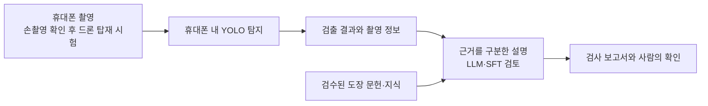
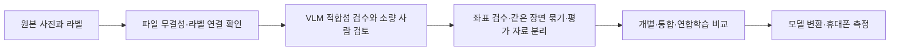

# 시스템 구성

[프로젝트 소개로 돌아가기](../README.md)

아래 그림은 **목표 구성**입니다. 모든 연결이 실제 장비에서 검증됐다는 뜻은 아닙니다.

핵심 흐름은 **촬영 → 휴대폰 탐지 → 검출 결과 전달 → 근거와 불확실성 표시 → 사람의 확인**입니다. 검출 위치만으로 결함의 원인이나 보수 방법을 확정하지 않습니다.

## 데이터 준비와 학습

현재 VLM은 시연과 가까운 사진 후보를 선별하는 데 사용합니다. 후보로 채택됐다고 라벨이 정확하거나 학습 효과가 입증된 것은 아닙니다. 스크래치가 불분명한 사진을 임의로 정상 정답으로 바꾸지도 않습니다.

연합학습은 데이터를 나눈 여러 참여자가 모델 업데이트를 모으는 학습 방식입니다. 우선 가상 참여 환경에서 비교할 계획이며, 이를 실제 현장 간 연합학습 실증으로 부르지 않습니다.

## 탐지와 설명은 어떻게 다른가요?

| 구성 | 역할 | 구분할 점 |
| --- | --- | --- |
| YOLO 탐지 | 사진에서 결함 후보 위치와 종류를 찾기 | 실제 사진의 오탐·미탐과 휴대폰 지연을 측정해야 합니다. |
| 템플릿 보고서 | 검출값을 정해진 문장과 항목에 넣기 | 언어모델 학습이나 근거 검색의 성과가 아닙니다. |
| LLM·SFT | 도메인 문답을 활용해 설명 생성 방식을 개선하는 연구 | 문답 자료 검수와 별도 평가가 먼저 필요합니다. |
| RAG | 관련 문헌을 검색한 뒤 근거를 참고해 설명 생성 | 목표 방법 중 하나이며 검색·생성 연결 완료를 주장하지 않습니다. |
| VLM 데이터 검수 | 이미지와 지시문을 함께 보고 후보 적합성 평가 | 현재 데이터 준비용입니다. 제품 진단의 정답을 보증하지 않습니다. |

문헌, 학습용 문답, 독립 평가 자료는 구분해 준비합니다. 보고서에는 관찰 사실과 참고 문헌, 추가 확인이 필요한 내용을 나누어 표시할 계획입니다.
